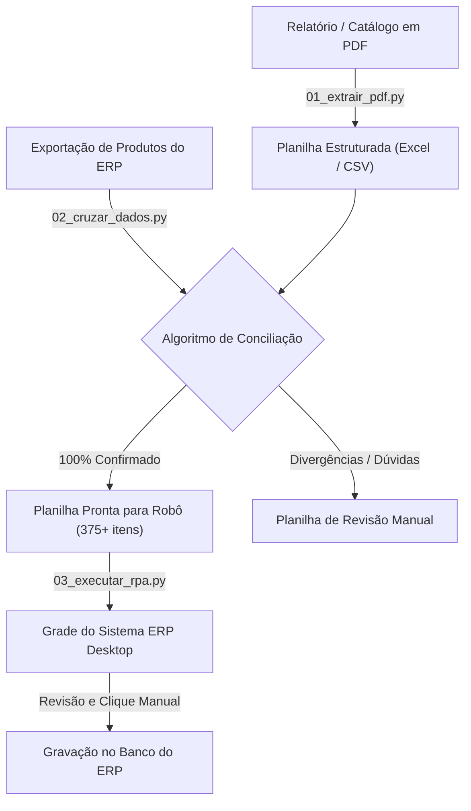

# Pipeline de Migração e Atualização de Preços (PDF -> ERP Desktop)

Solução completa de **Engenharia de Dados (ETL) e Automação de Processos (RPA)** desenvolvida para extrair dados tabulares de relatórios/catálogos em PDF, conciliar produtos com sistemas legados via algoritmos de correspondência de código (Part-Number & Fuzzy Matching) e atualizar preços de Custo e Venda diretamente na interface gráfica de sistemas desktop (grades interativas estilo *DevExpress*).

---

## 📌 Visão Geral do Desafio

Muitas empresas enfrentam gargalos manuais ao receber tabelas de preços de fornecedores em PDF sem acesso a APIs ou integrações diretas de banco de dados no ERP de destino. 

Este projeto resolve essa dor de ponta a ponta em 3 camadas:
1. **Extração Não Estruturada (PDF -> Tabela):** Processa documentos com dezenas de páginas, isolando códigos, descrições, NCM, unidades e preços.
2. **Cruzamento Inteligente (Data Reconciliation):** Cruza a listagem do sistema com o catálogo do fornecedor através de normalização de texto e identificação de *part-numbers* (códigos de modelo), separando automaticamente os itens com 100% de certeza e isolando divergências para validação humana.
3. **Automação Desktop (RPA Resiliente):** Um robô em Python que opera o sistema desktop simulando o operador de forma rápida e segura, filtrando o produto em tempo real, preenchendo os preços e resetando o cursor para o próximo registro.

---

## 🔒 Segurança, Privacidade e LGPD

> [!IMPORTANT]
> **Privacidade por Design:** Este repositório **NÃO contém dados reais de empresas, clientes, CNPJs ou preços proprietários**.
> * O arquivo `.gitignore` bloqueia estritamente extensões `.xlsx`, `.csv`, `.pdf` e arquivos `.log`.
> * Os arquivos na pasta `sample_data/` utilizam exclusivamente dados fictícios para fins de demonstração e testes unitários.
> * O robô de automação **NUNCA clica no botão "Gravar" / "Salvar"**. Ele preenche a grade em lote e devolve o controle ao usuário humano para conferência e confirmação final.
> * **Trava de Emergência (Fail-Safe):** Mover o mouse para qualquer canto da tela aborta o robô instantaneamente.

---

## 🏗️ Arquitetura do Pipeline



---

## 🛠️ Tecnologias Utilizadas

* **Python 3.12+**
* **pdfplumber & pypdf:** Extração vetorial de textos e coordenadas de documentos PDF.
* **pandas & openpyxl:** Engenharia de atributos, normalização e manipulação tabular.
* **pyautogui & pyperclip:** Automação de interface de usuário (GUI) com suporte a atalhos e clipboard seguro.
* **Windows Win32 API (`ctypes`):** Conexão com desktops interativos e controle de sessões do Windows.

---

## 🚀 Instalação e Configuração

### 1. Clonar o repositório
```bash
git clone https://github.com/leandrinhoaraujo/migracao-estoque-rpa.git
cd migracao-estoque-rpa
```

### 2. Criar e ativar o ambiente virtual (Recomendado)
```bash
python -m venv .venv
# No Windows PowerShell:
.\.venv\Scripts\Activate.ps1
```

### 3. Instalar as dependências
```bash
pip install -r requirements.txt
```

### 4. Configurar variáveis de ambiente (Opcional)
Copie o arquivo de exemplo caso deseje personalizar os diretórios:
```bash
copy .env.example .env
```

---

## 📖 Como Usar o Pipeline

### Etapa 1: Extrair dados do PDF
Coloque o PDF na pasta `data/catalogo_fornecedor.pdf` ou execute passando o caminho do arquivo:
```bash
python 01_extrair_pdf.py "caminho/para/meu_catalogo.pdf"
```
*Gera os arquivos `produtos_estoque_extraido.xlsx` e `.csv` na pasta `data/`.*

### Etapa 2: Conciliar com a planilha do ERP
Com o arquivo do catálogo e a exportação do seu ERP na pasta `data/`, execute:
```bash
python 02_cruzar_dados.py "data/produtos_sistema.xlsx" "data/produtos_estoque_extraido.xlsx"
```
*Gera a planilha consolidada `cruzamento_produtos_final.xlsx` com duas abas:*
* **AUTOMATIZAR (100% CERTEZA):** Itens com casamento exato de modelo prontos para o robô.
* **FAZER MANUAL:** Itens sem correspondência exata para conferência visual.

### Etapa 3: Executar a automação RPA
Abra o sistema ERP na tela de produtos e execute:
```bash
# Executa um lote padrão (20 produtos)
python 03_executar_rpa.py

# Ou especifique o tamanho do lote desejado:
python 03_executar_rpa.py 50
```

1. O script dá **5 segundos de contagem regressiva** para você focar a janela do ERP.
2. Ele executa o fluxo validado:
   * Abre a busca rápida (`Ctrl + F`);
   * Digita o nome do produto e aguarda 2 segundos para o filtro em tempo real;
   * Entra na linha (`Seta para Baixo`);
   * Preenche **Custo**, **Custo Inicial** e **Preço de Venda**;
   * Retorna o foco inicial com 5 comandos `Shift + Tab`;
   * Registra o item no log `produtos_processados.log` para nunca repetir registros.
3. No final, você revisa os valores na tela e clica no botão **Gravar** manualmente.

---

## ⚙️ Ajustes Finos de Interface

Caso o seu sistema tenha tempos de resposta diferentes ou outra quantidade de colunas na grade, ajuste no arquivo [config.py](file:///C:/Users/AtonSystems/.gemini/antigravity/scratch/migracao_estoque/config.py) ou no `.env`:

| Parâmetro | Padrão | Descrição |
| :--- | :--- | :--- |
| `TEMPO_FILTRO_SEGUNDOS` | `2.0` | Tempo de espera para o sistema estabilizar a grade após pesquisar |
| `QTD_SHIFT_TABS_RETORNO` | `5` | Número de Shift+Tabs para voltar o cursor para a primeira coluna |
| `TAMANHO_LOTE_PADRAO` | `20` | Quantidade de itens preenchidos por rodada |
| `PAUSA_ENTRE_COMANDOS` | `0.12` | Intervalo em segundos entre toques no teclado |

---

## 📄 Licença
Distribuído sob a licença MIT. Consulte `LICENSE` para mais informações.
